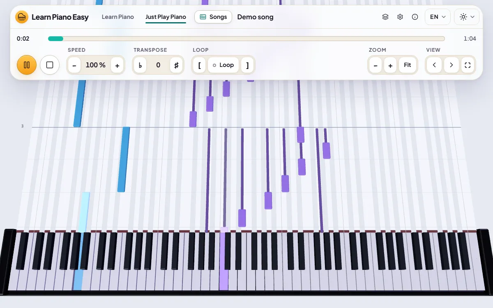
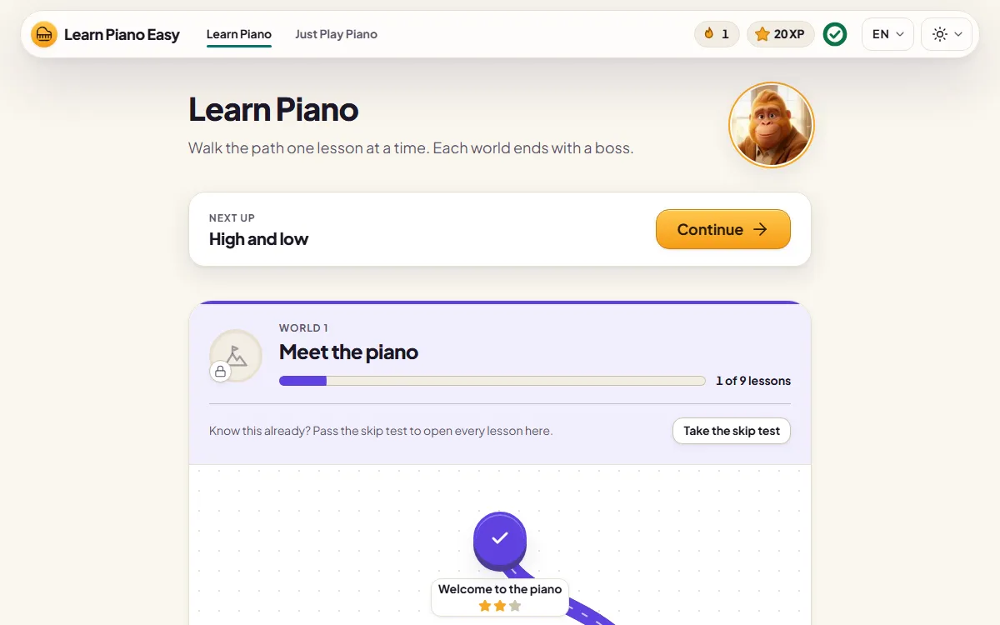

<h1 align="center">
  <br />
  Learn Piano Easy
</h1>

<p align="center">
  <strong>Learn piano in your browser.</strong> Free, open source, offline, and no account needed.
</p>

<p align="center">
  <a href="https://learn-piano-easy.app"><strong>Open the app</strong></a> ·
  <a href="https://learn-piano-easy.app/de/">Deutsch</a> ·
  <a href="https://learn-piano-easy.app/es/">Español</a> ·
  <a href="https://learn-piano-easy.app/zh/">简体中文</a> ·
  <a href="https://learn-piano-easy.app/hi/">हिन्दी</a> ·
  <a href="https://learn-piano-easy.app/sponsor/">Sponsor</a>
</p>

<p align="center">
  <a href="https://github.com/brainfoolong/learn-piano-easy/actions/workflows/ci.yml"></a>
  <a href="LICENSE"></a>
  <a href="https://github.com/sponsors/brainfoolong"></a>
</p>



Notes fall towards a 3D piano, and you play them on your MIDI keyboard, your computer keyboard or the
screen. The app checks each note and tells you what you hit. It runs in any modern browser and installs
as an app.

## Two ways to play

**"Learn Piano"** is a course from your first key to your first songs. It has eight worlds of short
lessons, and each world ends with a boss lesson. Each lesson earns stars and XP, and a daily streak
counts the days you play.

**"Just Play Piano"** opens any song of the library, or a MIDI or MusicXML file of your own. Slow it down,
loop a hard bar, or let the song wait until you hit each note.



## Features

- **Hundreds of songs,** from nursery rhymes to the classics. Our own arrangements come in four versions,
  from Beginner to Hard.
- **Wait mode** for each hand alone or both together, and a loop trainer that raises the speed.
- **Sheet music** above the falling notes or on its own, and note names or fingering on the notes and keys.
- **Your own keyboard,** drawn key for key, so the screen matches the 25 to 88 keys in front of you.
- **MIDI in and out.** A keyboard with lit keys shows you what to play.
- **Accuracy history** per song, and your playing saved as a MIDI file.
- **Offline first.** After the first visit, the app runs offline, and so does every song you have opened.
- **Private by design.** Your progress stays in your browser. The hosted site counts page visits,
  without cookies.
- **English, German, Spanish, Chinese and Hindi,** in light and dark themes, on a phone or a desktop.

[docs/reference/features.md](docs/reference/features.md) lists every feature in detail.

## Run it yourself

The app is a static site, so any web server can host it, at any path.

- **Download** the zip of a [release](https://github.com/brainfoolong/learn-piano-easy/releases) and
  serve the unpacked folder.
- **Or build it** with [Bun](https://bun.sh):

```
bun install
bun run build                               # the static app in dist/
bun run dev                                 # the app at http://localhost:4173, with live reload
```

[CONTRIBUTING.md](CONTRIBUTING.md) has the full setup for contributors, including the tests.

## Support the project

Learn Piano Easy is made by one person in their spare time. If it helps you play, you can
[sponsor it on GitHub](https://github.com/sponsors/brainfoolong). A star, a bug report or a word to a
friend helps too.

## License

Our code and our own songs are under the [MIT License](LICENSE). The third-party songs, sounds, font
and icons keep their own licenses, which [THIRD-PARTY-NOTICES.md](THIRD-PARTY-NOTICES.md) names one by one.

## Layout

Every top-level entry is named in one row. `looper layout --check` fails when this table and the tree
disagree.

| Path | Holds |
|---|---|
| `AGENTS.md` | the rules for every agent working here |
| `README.md` | this file |
| `LICENSE` | the MIT License of our own code |
| `THIRD-PARTY-NOTICES.md` | every third-party work we carry, with its author, source and license |
| `CONTRIBUTING.md`, `CODE_OF_CONDUCT.md`, `SECURITY.md` | how to contribute, how we treat each other, and how to report a vulnerability |
| `looper.toml` | the project's looper config |
| `docs/` | the design, the curriculum, our songs, the decisions, the goals, the findings, the reference and the agent docs |
| `tools/` | the git hooks, the kit's copy in `tools/looper/`, the `loop` shims, the build and dev tools, and the tools that make the songs, sounds and pictures |
| `package.json`, `bun.lock` | the package, its scripts and its locked dependencies |
| `tsconfig.json`, `bunfig.toml` | the TypeScript and bun config |
| `src/` | the app's source and its tests |
| `e2e/`, `playwright.config.ts` | the end-to-end tests, which Playwright runs in Chromium against the production build |
| `public/` | the app's static files: the page template, the manifest, the font, icons, pictures, songs and sounds |
